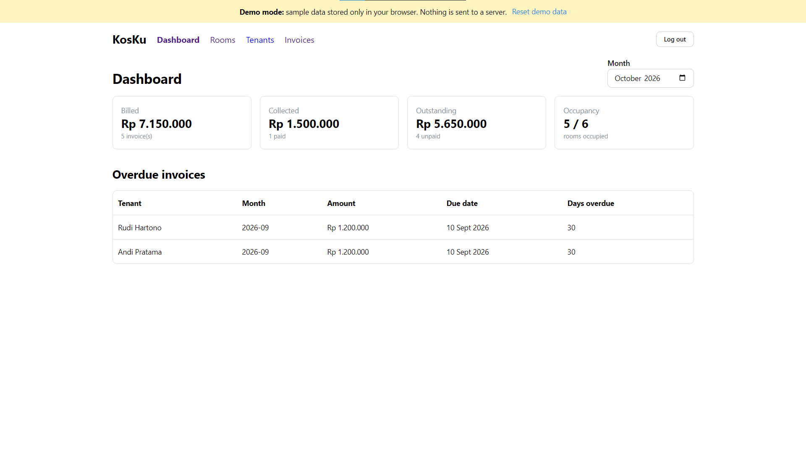
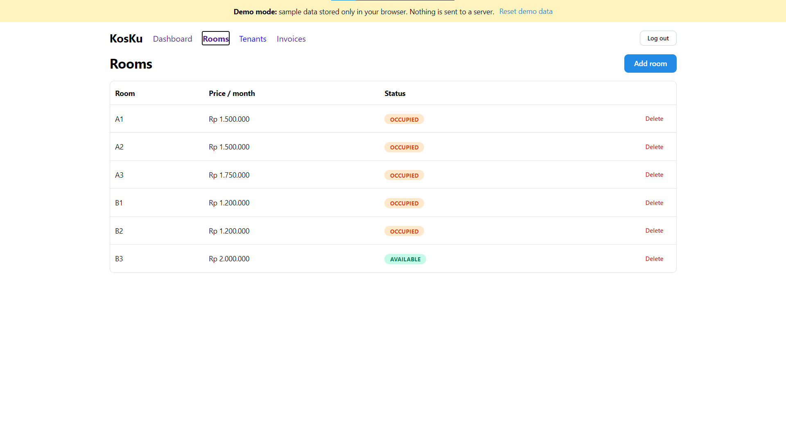
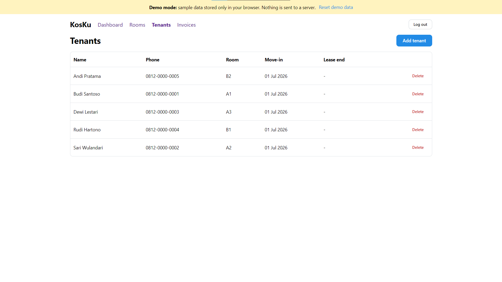
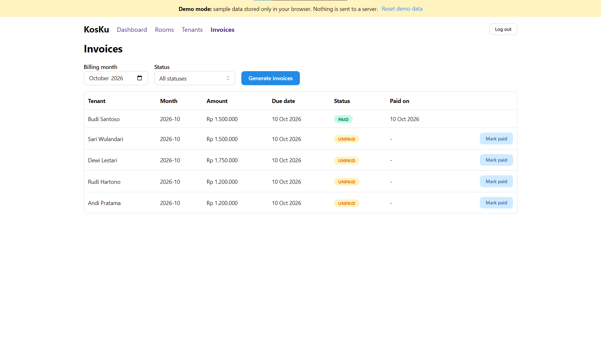

# KosKu Web
 
[](https://github.com/naufalraism/kosku-web/actions/workflows/ci.yml)
 
React + TypeScript frontend for [KosKu API](https://github.com/naufalraism/kosku-api), a boarding-house (kost) management system: rooms, tenants, monthly invoices, and a dashboard with overdue payments.
 
**Live demo:** https://kosku-web.naufal-majid.workers.dev
 
The demo runs entirely in your browser on sample data; no backend is called. The login is pre-filled, so just press *Sign in*. Use *Reset demo data* in the banner to start over.
 
## Screenshots
 
<p align="center">
  
  
  
  
</p>
## Features
 
- Login (JWT when connected to the real API)
- Rooms: list, add, delete
- Tenants: add to an available room, delete
- Invoices: generate per month, filter by status, mark as paid, overdue highlighting
- Dashboard: billed, collected and outstanding totals, occupancy, overdue list
- Demo mode: the whole app runs on sample data with no backend
## Tech stack
 
React, TypeScript, Vite, Mantine, React Router. Served as static assets on Cloudflare Workers. CI with GitHub Actions.
 
## Run locally
 
**Demo mode (no backend needed)**
 
```bash
cp .env.example .env     # then set VITE_DEMO=true in .env
npm install
npm run dev              # http://localhost:5173
```
 
**With the real API**
 
1. Start the API (see the [kosku-api README](https://github.com/naufalraism/kosku-api)) so it listens on http://localhost:3000.
2. Keep `VITE_DEMO=false` in `.env`, then run `npm install` and `npm run dev`.
On Windows PowerShell, use `Copy-Item .env.example .env` instead of `cp`.
 
## Environment variables
 
| Variable | Purpose |
|---|---|
| `VITE_API_URL` | Base URL of the API (default `http://localhost:3000`) |
| `VITE_DEMO` | `true` runs the app on in-browser sample data and never calls the API |
 
## How demo mode works
 
`src/demo/demoApi.ts` is a small in-browser imitation of the API. It follows the same rules as the real backend (unique room numbers, room status changes, invoice generation, overdue logic) and keeps its data in `localStorage`. When `VITE_DEMO=true`, `src/api.ts` routes every request to it instead of the network.
 
## Project structure
 
```text
src/
  api.ts            HTTP client (switches to the demo API when VITE_DEMO=true)
  auth.tsx          auth context (JWT kept in localStorage)
  demo/demoApi.ts   in-browser fake API with sample data
  pages/            Login, Dashboard, Rooms, Tenants, Invoices
  components/       Layout
```
 
## Deployment
 
The app is built with Vite and deployed as static assets on Cloudflare Workers (see `wrangler.jsonc`). The production build reads `.env.production`, which sets `VITE_DEMO=true`, so the public site always runs in demo mode.
 
## CI
 
GitHub Actions runs on every pull request and push to `main`: install without lifecycle scripts, type-check and build, and `npm audit` on production dependencies.
 
## Status
 
- [x] Login
- [x] Rooms
- [x] Tenants
- [x] Invoices
- [x] Dashboard
- [x] Public demo with sample data
- [ ] Real backend hosted online (optional, see the API README)